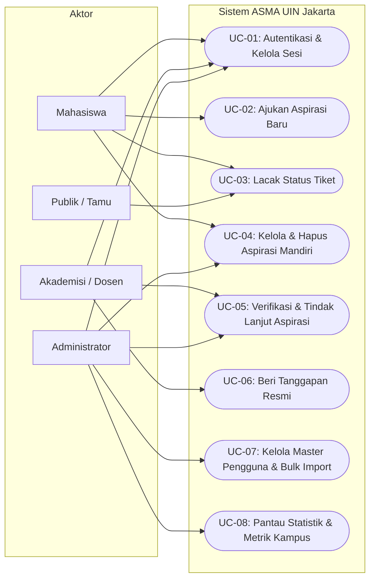
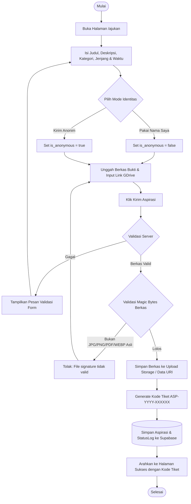
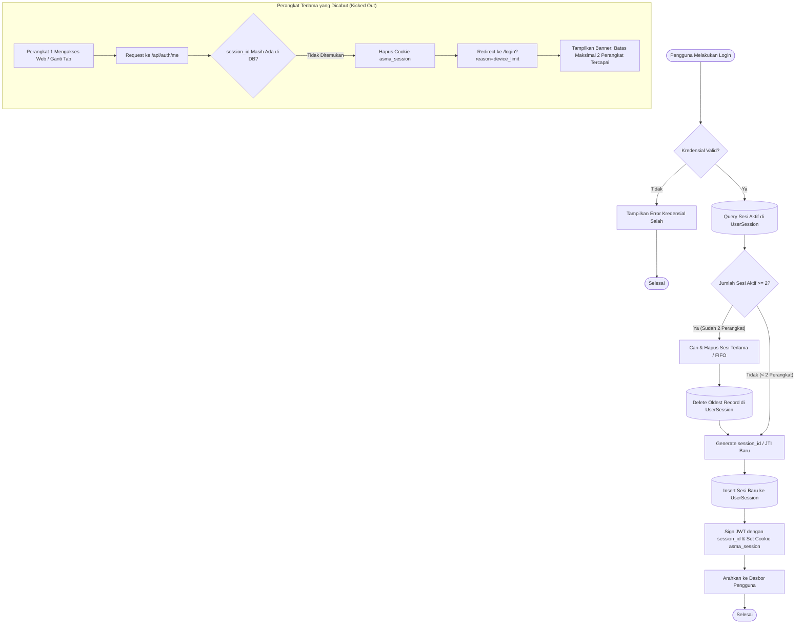
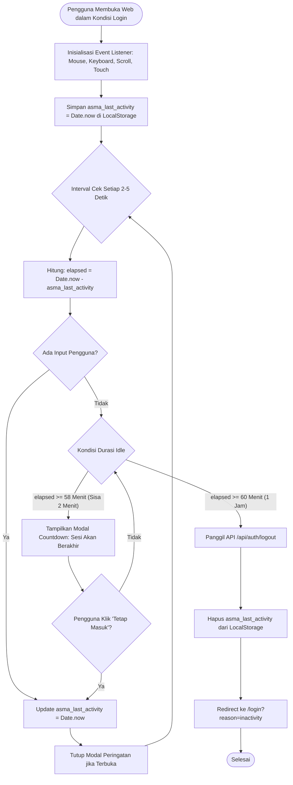
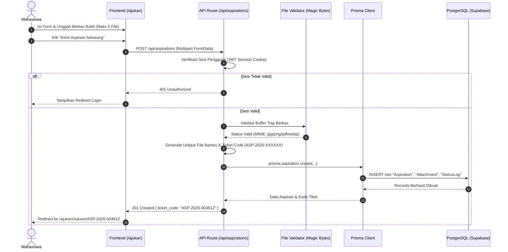
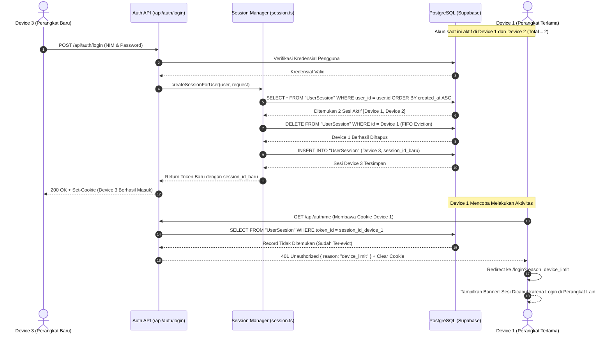
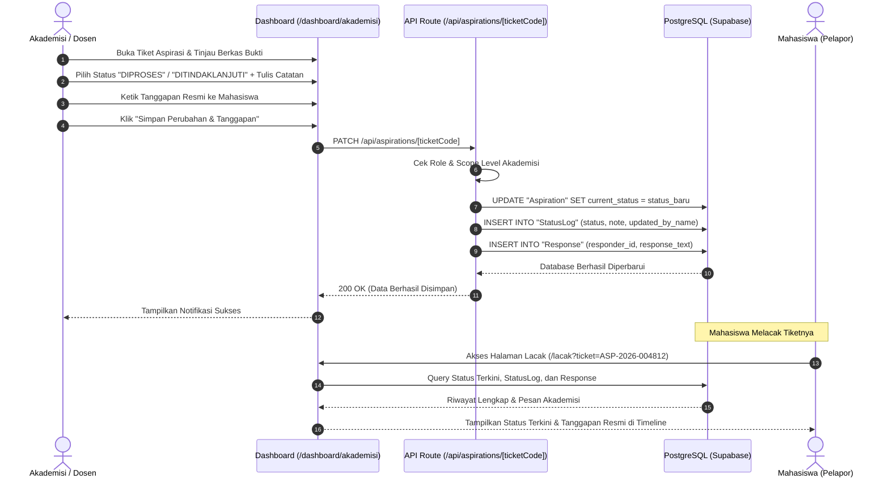
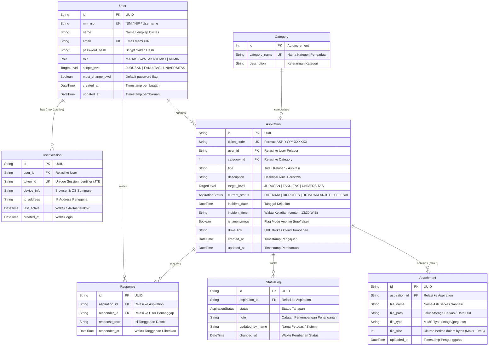

# DOKUMENTASI SPESIFIKASI & REKAYASA PERANGKAT LUNAK
## SISTEM INFORMASI ASPIRASI MAHASISWA (ASMA)
### UIN Syarif Hidayatullah Jakarta

---

## DAFTAR ISI
1. [Gambaran Umum Sistem](#1-gambaran-umum-sistem)
2. [Functional Requirements (Kebutuhan Fungsional)](#2-functional-requirements-kebutuhan-fungsional)
3. [Use Case Diagram & Spesifikasi Use Case](#3-use-case-diagram--spesifikasi-use-case)
4. [Activity Diagram (Diagram Aktivitas)](#4-activity-diagram-diagram-aktivitas)
5. [Sequence Diagram (Diagram Urutan)](#5-sequence-diagram-diagram-urutan)
6. [Entity Relationship Diagram (ERD) & Kamus Data](#6-entity-relationship-diagram-erd--kamus-data)
7. [Arsitektur Keamanan & Deployment](#7-arsitektur-keamanan--deployment)

---

## 1. Gambaran Umum Sistem

**ASMA (Aspirasi Mahasiswa)** adalah platform web resmi civitas akademika UIN Syarif Hidayatullah Jakarta yang dirancang untuk menyampaikan aspirasi, keluhan, kritik, dan saran konstruktif dari mahasiswa kepada pihak universitas secara aman, transparan, terstruktur, dan akuntabel.

### Karakteristik Utama Sistem:
* **Multi-Level Scope Routing**: Aspirasi dapat dialamatkan secara presisi ke tingkat **Jurusan/Program Studi**, **Fakultas**, maupun **Tingkat Universitas (Rektorat)**.
* **Dual Privacy Mode**: Mendukung mode **Transparan** (identitas pelapor terbuka) dan mode **Anonim** (identitas mahasiswa disensor 100% oleh sistem di sisi peninjau).
* **Multi-Evidence Support**: Pengunggahan berkas bukti hingga 5 file (maks. 10MB/file: JPG, PNG, PDF, WEBP) dengan validasi *magic bytes* dan integrasi tautan berkas cloud (Google Drive).
* **Self-Service Aspiration Management**: Mahasiswa dapat membatalkan/menghapus aspirasinya sendiri yang baru dibuat dengan proteksi ketat Anti-IDOR.
* **Enterprise-Grade Session Security**:
  * Pembatasan sesi login simultan maksimal **2 perangkat aktif** per akun (mekanisme FIFO Eviction otomatis).
  * Fitur **Auto-Logout setelah 1 jam inaktivitas** dengan sinkronisasi antar-tab dan modal peringatan pada menit ke-58.
  * Wajib perbarui password default pada login pertama dengan 6 kriteria keamanan kata sandi.

### Stack Teknologi:
* **Frontend & Backend**: Next.js 15 (App Router, Server Actions, Dynamic API Handlers) & React 19
* **Database & ORM**: PostgreSQL (Supabase Connection Pooler) & Prisma ORM v6
* **Autentikasi & Enkripsi**: Stateless Signed JWT (`jose` HS256), Bcrypt.js (Salt Rounds 10)
* **Styling & UI**: Tailwind CSS, Lucide React
* **Infrastruktur Deployment**: Vercel Serverless Hosting

---

## 2. Functional Requirements (Kebutuhan Fungsional)

Tabel berikut mendefinisikan kebutuhan fungsional sistem ASMA dengan klasifikasi prioritas:
* **High (H)**: Fitur inti yang wajib ada dan krusial untuk operasional sistem.
* **Medium (M)**: Fitur pendukung integritas dan kemudahan tata kelola.
* **Low (L)**: Fitur pelengkap estetika dan kenyamanan tambahan.

### 2.1 Modul Autentikasi & Keamanan Sesi (AUTH)

| Kode FR | Deskripsi Kebutuhan Fungsional | Aktor | Prioritas |
| :--- | :--- | :--- | :---: |
| **FR-AUTH-01** | Sistem harus mengotentikasi pengguna menggunakan NIM (Mahasiswa), NIP (Dosen/Akademisi), atau Username (Admin) beserta password yang telah di-hash dengan Bcrypt. | Mahasiswa, Akademisi, Admin | **H** |
| **FR-AUTH-02** | Sistem harus membatasi sesi login maksimal **2 perangkat aktif** secara bersamaan per akun pengguna. Jika perangkat ke-3 login, sistem secara otomatis mencabut (*evict*) sesi pada perangkat terlama (FIFO). | Semua Pengguna | **H** |
| **FR-AUTH-03** | Sistem harus memantau aktivitas pengguna dan secara otomatis melakukan *logout* jika pengguna tidak melakukan aktivitas (*idle*) selama **1 jam (60 menit)**, disertai modal countdown pada menit ke-58 dan sinkronisasi antar-tab. | Semua Pengguna | **H** |
| **FR-AUTH-04** | Sistem harus mendeteksi penggunaan password default sistem (`Uin<NIM/NIP>`) dan mewajibkan pengguna mengganti password sesuai 6 kriteria keamanan (minimal 8 karakter, huruf besar, huruf kecil, angka, simbol, tanpa spasi), dengan opsi tunda (*Nanti*). | Semua Pengguna | **H** |
| **FR-AUTH-05** | Sistem harus menerapkan *Rate Limiting* anti *brute-force* pada endpoint login (maksimal 10 percobaan gagal per 5 menit per alamat IP). | Publik / Pengguna | **H** |
| **FR-AUTH-06** | Sistem harus menyediakan fitur *Logout* aman yang menghapus cookie sesi browser (`asma_session`) dan menghapus data sesi perangkat dari tabel `UserSession` di database. | Semua Pengguna | **H** |

### 2.2 Modul Pengajuan Aspirasi (ASP)

| Kode FR | Deskripsi Kebutuhan Fungsional | Aktor | Prioritas |
| :--- | :--- | :--- | :---: |
| **FR-ASP-01** | Sistem harus menyediakan formulir pengajuan aspirasi terpadu (1 halaman) yang mencakup: Judul, Deskripsi, Kategori Pengaduan, Jenjang Wewenang Tujuan (Jurusan, Fakultas, Universitas), serta Tanggal & Waktu Kejadian. | Mahasiswa | **H** |
| **FR-ASP-02** | Sistem harus menyediakan opsi privasi: **Mode Transparan** (Nama & NIM terbuka) dan **Mode Anonim** (Nama, NIM, dan email otomatis disensor oleh sistem menjadi `Mahasiswa (Anonim)` di sisi peninjau). | Mahasiswa | **H** |
| **FR-ASP-03** | Sistem harus mendukung pengunggahan multi-lampiran bukti fisik hingga maksimal **5 file** dengan ukuran maksimal **10 MB per file** untuk format berkas JPG, PNG, PDF, dan WEBP. | Mahasiswa | **H** |
| **FR-ASP-04** | Sistem harus memverifikasi keaslian tipe berkas yang diunggah menggunakan validasi *deep magic bytes* (file signature) di sisi server untuk mencegah serangan ekstensi palsu atau executable upload. | Sistem | **H** |
| **FR-ASP-05** | Sistem harus menyediakan input tautan penyimpanan cloud (Google Drive / OneDrive) opsional sebagai bukti tambahan tanpa batas kapasitas lokal. | Mahasiswa | **M** |
| **FR-ASP-06** | Sistem harus menghasilkan Kode Tiket unik berformat `ASP-YYYY-XXXXXX` (contoh: `ASP-2026-004812`) secara otomatis saat aspirasi berhasil disubmit. | Sistem | **H** |

### 2.3 Modul Pelacakan Publik (TRK)

| Kode FR | Deskripsi Kebutuhan Fungsional | Aktor | Prioritas |
| :--- | :--- | :--- | :---: |
| **FR-TRK-01** | Sistem harus menyediakan antarmuka pencarian publik untuk melacak status aspirasi hanya dengan memasukkan Kode Tiket tanpa harus login. | Publik / Mahasiswa | **H** |
| **FR-TRK-02** | Sistem harus menampilkan timeline progres visual perjalanan aspirasi (Diterima $\rightarrow$ Diproses $\rightarrow$ Ditindaklanjuti $\rightarrow$ Selesai), riwayat catatan petugas, dan tanggapan resmi. | Publik / Mahasiswa | **H** |
| **FR-TRK-03** | Sistem harus menyensor informasi identitas pelapor pada hasil pencarian publik jika aspirasi tersebut diajukan dengan mode anonim. | Sistem | **H** |

### 2.4 Modul Dasbor Mahasiswa (MHS)

| Kode FR | Deskripsi Kebutuhan Fungsional | Aktor | Prioritas |
| :--- | :--- | :--- | :---: |
| **FR-MHS-01** | Sistem harus menampilkan daftar seluruh aspirasi pribadi yang pernah diajukan oleh mahasiswa yang sedang login beserta status terkininya. | Mahasiswa | **H** |
| **FR-MHS-02** | Sistem harus menyediakan fitur pencarian kata kunci dan penyaringan (*filtering*) aspirasi berdasarkan status (`DITERIMA`, `DIPROSES`, `DITINDAKLANJUTI`, `SELESAI`). | Mahasiswa | **M** |
| **FR-MHS-03** | Mahasiswa harus dapat melihat modal detail lengkap aspirasi miliknya termasuk berkas bukti lampiran, tautan Google Drive, dan tanggapan pejabat peninjau. | Mahasiswa | **H** |
| **FR-MHS-04** | Mahasiswa harus dapat membatalkan / menghapus aspirasi buatannya sendiri (*Self-Service Delete*) dengan modal konfirmasi dan proteksi Anti-IDOR (hanya pemilik sah yang dapat menghapus). | Mahasiswa | **H** |
| **FR-MHS-05** | Sistem harus menghapus seluruh berkas lampiran fisik pada storage saat aspirasi dihapus. | Sistem | **H** |

### 2.5 Modul Dasbor Akademisi / Dosen Peninjau (AKAD)

| Kode FR | Deskripsi Kebutuhan Fungsional | Aktor | Prioritas |
| :--- | :--- | :--- | :---: |
| **FR-AKAD-01** | Sistem harus menyaring dan menampilkan daftar aspirasi yang masuk sesuai tingkat wewenang akun akademisi yang bersangkutan (`JURUSAN`, `FAKULTAS`, atau `UNIVERSITAS`). | Akademisi | **H** |
| **FR-AKAD-02** | Akademisi harus dapat meninjau rincian aspirasi, mengunduh bukti lampiran, dan membuka tautan Google Drive pelapor. | Akademisi | **H** |
| **FR-AKAD-03** | Akademisi harus dapat memperbarui status aspirasi secara bertahap (`DITERIMA` $\rightarrow$ `DIPROSES` $\rightarrow$ `DITINDAKLANJUTI` $\rightarrow$ `SELESAI`) disertai catatan progres penanganan. | Akademisi | **H** |
| **FR-AKAD-04** | Akademisi harus dapat menuliskan dan mempublikasikan tanggapan resmi (*Official Response*) yang dapat dibaca oleh mahasiswa pelapor. | Akademisi | **H** |

### 2.6 Modul Dasbor Administrator (ADM)

| Kode FR | Deskripsi Kebutuhan Fungsional | Aktor | Prioritas |
| :--- | :--- | :--- | :---: |
| **FR-ADM-01** | Sistem harus menampilkan ringkasan metrik statistik real-time: total pengguna, total aspirasi masuk, persentase penyelesaian, serta sebaran kategori dan tingkat jenjang. | Admin | **H** |
| **FR-ADM-02** | Admin dapat melakukan manajemen akun pengguna (Create, Read, Update, Delete) untuk role Mahasiswa, Akademisi, dan Admin. | Admin | **H** |
| **FR-ADM-03** | Admin dapat melakukan import massal (*Bulk Import*) data civitas akademika menggunakan format file CSV atau Excel. | Admin | **M** |
| **FR-ADM-04** | Admin dapat melakukan reset password akun pengguna yang lupa kata sandi kembali ke format default sistem. | Admin | **M** |

---

## 3. Use Case Diagram & Spesifikasi Use Case

### 3.1 Diagram Use Case Sistem



### 3.2 Spesifikasi Naratif Use Case

#### Use Case UC-02: Mengajukan Aspirasi Baru
* **Aktor Utama**: Mahasiswa
* **Deskripsi**: Mahasiswa menyampaikan aspirasi/laporan permasalahan perkuliahan atau fasilitas ke unit terkait.
* **Pre-kondisi**: Mahasiswa telah login ke sistem.
* **Post-kondisi**: Aspirasi tercatat dengan status `DITERIMA` dan kode tiket `ASP-YYYY-XXXXXX` diterbitkan.
* **Alur Utama (Main Flow)**:
  1. Mahasiswa membuka halaman form pengajuan aspirasi (`/ajukan`).
  2. Mahasiswa mengisi judul, deskripsi kejadian, kategori, jenjang wewenang (Jurusan/Fakultas/Universitas), tanggal, dan jam kejadian.
  3. Mahasiswa memilih mode pelaporan: **Transparan** atau **Anonim**.
  4. Mahasiswa melampirkan berkas bukti (1 - 5 file: JPG, PNG, PDF, WEBP maks 10MB) dan/atau memasukkan tautan Google Drive.
  5. Mahasiswa menekan tombol **"Kirim Aspirasi Sekarang"**.
  6. Sistem memvalidasi input, memeriksa *magic bytes* berkas, menyimpan data ke Supabase, dan menerbitkan tiket.
  7. Sistem mengarahkan mahasiswa ke halaman sukses penyerahan tiket (`/ajukan/sukses/[ticketCode]`).

#### Use Case UC-04: Menghapus Aspirasi Mandiri
* **Aktor Utama**: Mahasiswa (Pemilik Tiket) atau Admin
* **Deskripsi**: Menghapus aspirasi yang keliru atau dibatalkan oleh mahasiswa itu sendiri.
* **Pre-kondisi**: Mahasiswa login dan memiliki aspirasi pada dasbornya.
* **Alur Utama**:
  1. Mahasiswa membuka Dasbor Mahasiswa (`/dashboard/mahasiswa`).
  2. Mahasiswa mengklik tombol **Hapus** pada kartu aspirasi yang ingin dibatalkan.
  3. Sistem menampilkan modal konfirmasi penghapusan permanen.
  4. Mahasiswa mengonfirmasi dengan menekan tombol **"Hapus Aspirasi"**.
  5. Sistem menjalankan verifikasi Anti-IDOR (`user_id === session.id`).
  6. Sistem menghapus relasi lampiran, status log, respons, record aspirasi dari database, serta berkas fisik terkait.
  7. Sistem memperbarui antarmuka dasbor dan menampilkan toast sukses.

---

## 4. Activity Diagram (Diagram Aktivitas)

### 4.1 Activity Diagram: Pengajuan Aspirasi oleh Mahasiswa



### 4.2 Activity Diagram: Pembatasan Maksimal 2 Perangkat (Concurrent Device Limit)



### 4.3 Activity Diagram: Pemantauan Inaktivitas 1 Jam (Auto-Logout)



---

## 5. Sequence Diagram (Diagram Urutan)

### 5.1 Sequence Diagram: Pengajuan Aspirasi Baru oleh Mahasiswa



### 5.2 Sequence Diagram: Manajemen Batas 2 Perangkat Aktif (Device Limit Eviction)



### 5.3 Sequence Diagram: Tindak Lanjut & Tanggapan Resmi oleh Akademisi



---

## 6. Entity Relationship Diagram (ERD) & Kamus Data

### 6.1 Diagram ERD Relasional



### 6.2 Kamus Data & Batasan Atribut (Data Dictionary)

1. **`User`**:
   * `nim_nip`: `VARCHAR(50)`, Unique, Not Null. Kunci pencarian otentikasi utama.
   * `role`: Enum (`MAHASISWA`, `AKADEMISI`, `ADMIN`).
   * `scope_level`: Enum Nullable (`JURUSAN`, `FAKULTAS`, `UNIVERSITAS`).
   * `must_change_pwd`: `BOOLEAN`, Default `true`. Mengontrol kemunculan modal ganti kata sandi.

2. **`UserSession`**:
   * `token_id`: `VARCHAR(255)`, Unique, Not Null, Indexed. Mengaitkan payload JWT secara *stateful* ke database untuk menegakkan batas **2 perangkat aktif**.
   * `device_info`: `VARCHAR(255)`. Menyimpan informasi ringkas perangkat (misal: `Chrome (Windows PC)`).

3. **`Aspiration`**:
   * `ticket_code`: `VARCHAR(32)`, Unique, Not Null, Indexed. Kode pelacakan publik (format `ASP-YYYY-XXXXXX`).
   * `is_anonymous`: `BOOLEAN`, Default `false`. Menentukan apakah nama mahasiswa disamarkan pada API peninjau dan publik.
   * `drive_link`: `TEXT`, Nullable. Menampung URL tautan Google Drive / OneDrive.

4. **`Attachment`**:
   * `file_size`: `INTEGER`. Dibatasi maksimal 10.485.760 bytes (10 MB).
   * `file_path`: `TEXT`. Menyimpan direktori berkas aman atau fallback Base64 Data URI untuk kompatibilitas lingkungan Serverless Read-Only.

---

## 7. Arsitektur Keamanan & Deployment

```
[ Klien Mahasiswa / Dosen ]
            │
            ▼ (HTTPS / TLS 1.3)
   [ Vercel Edge Network ]
            │
            ├─► Middleware.ts (JWT Route Protection & Role Boundary)
            │
            ├─► Next.js 15 Serverless Lambdas
            │       ├─► Safe JWT Secret Fallback (Non-blocking build)
            │       ├─► Deep Magic Bytes Signature Validator (Anti-RCE)
            │       ├─► Anti-IDOR Authorization Guard
            │       └─► Inactivity & Multi-Device Session Controller
            │
            ▼ (Encrypted PostgreSQL Pooler TCP Port 5432 / 6543)
  [ Supabase Cloud Database (Singapore - ap-southeast-1) ]
            ├─► User & UserSession Tables (Max 2 Concurrent Devices)
            ├─► Aspiration & Attachment Tables
            └─► StatusLog & Response Tables
```

### Jaminan Keamanan Sistem:
1. **Perlindungan Terhadap Ancaman IDOR (Insecure Direct Object Reference)**:
   Penghapusan aspirasi diverifikasi ketat di level API:
   ```ts
   if (session.role === 'MAHASISWA' && aspiration.user_id !== session.id) {
     return NextResponse.json({ error: 'Akses ditolak.' }, { status: 403 });
   }
   ```
2. **Perlindungan Ekstensi Berkas Palsu**:
   Validasi pengunggahan tidak mempercayai header browser (`Content-Type`), melainkan membaca langsung *byte signature* awal berkas biner (contoh: `FF D8 FF` untuk JPEG, `89 50 4E 47` untuk PNG, `%PDF` untuk PDF).
3. **Pemisahan Perangkat Bersih (FIFO Device Revocation)**:
   Setiap kali pengguna login dari perangkat ketiga, *record* sesi tertua dihapus dari PostgreSQL, menyebabkan perangkat lama langsung ter-logout saat melakukan navigasi berikutnya.

---
*Dokumen ini disusun sebagai acuan formal analisis, perancangan, dan pengembangan sistem perangkat lunak ASMA UIN Syarif Hidayatullah Jakarta.*
